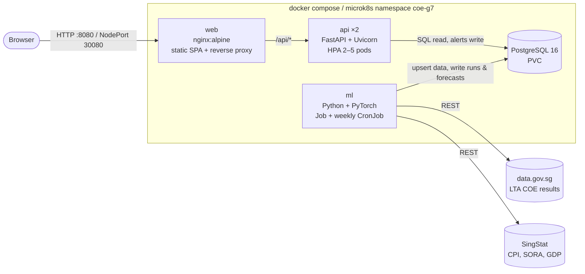
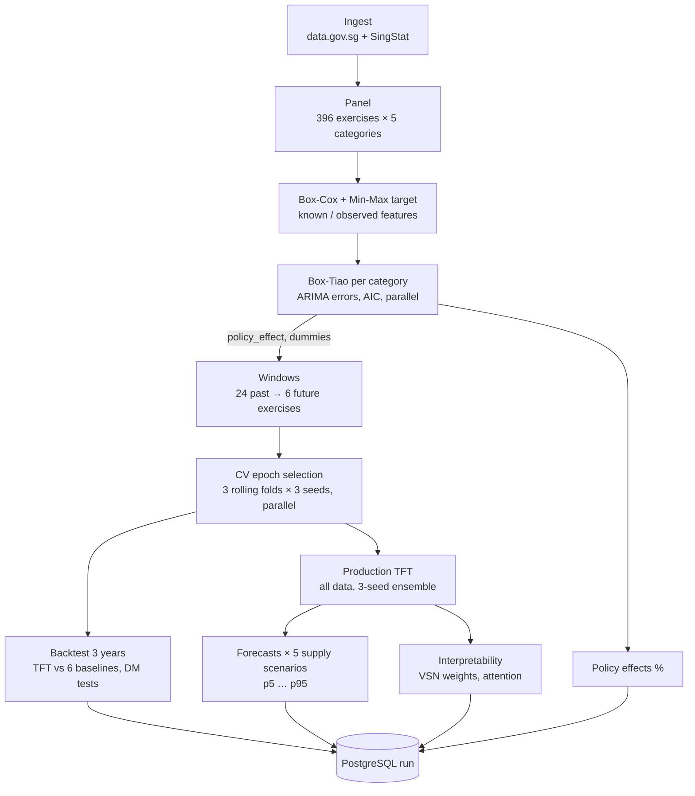
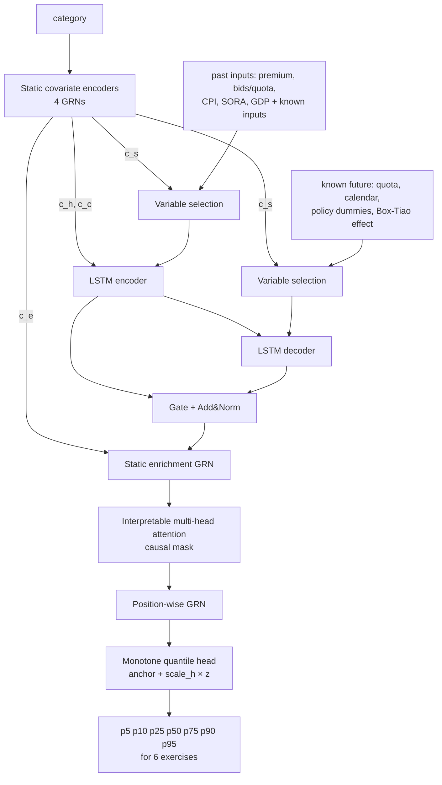

# System design

Material for report Section 3 (system design) and the presentation. Diagrams are Mermaid and
render directly on GitHub, or paste them into https://mermaid.live to export PNGs.

## 1. Deployment architecture



Design choices:

* **Batch training, online serving.** Training and forecasting run as a batch job after each
  bidding exercise; the API only reads pre-computed forecasts. The API image therefore needs no
  PyTorch (≈290 MB instead of ≈1.9 GB), answers in milliseconds and scales horizontally.
* **Stateless API and web tiers** run 2+ replicas behind Services (self-healing, rolling updates
  with `maxUnavailable: 0`). The stateful database is a single replica with a persistent volume.
* **Schema as code.** `db/init.sql` is idempotent and applied by both the ML job and the API on
  start-up, so pods can start in any order.
* **Offline fallback.** A CSV snapshot of all raw data ships in the ML image, so a network failure
  or API change never blocks retraining.

## 2. ML pipeline



## 3. Temporal Fusion Transformer (as implemented in `ml/coe_ml/models/tft.py`)



Differences from the original paper, and why:

| Change | Reason |
|---|---|
| Predict change from last premium (anchoring) | COE premiums are close to a random walk |
| Output scaled by the typical h-step move; head initialised at normal quantiles | An untrained network is a calibrated random walk, so training learns improvements on the strongest simple baseline |
| Monotone quantile head (median ± cumulative softplus) | No quantile crossing, so p10 ≤ p50 ≤ p90 always |
| Policy dummies switched off for events the training data cannot estimate | Prevents never-trained input weights from injecting noise when a new policy starts |

## 4. Evaluation protocol

* **Test period:** last 72 exercises (3 years). Nothing from it is used for fitting, scaling, the
  Box-Tiao estimates or choosing epochs.
* **Rolling origins:** a forecast is made from every exercise in the test period, 1–6 steps ahead,
  using only data up to that origin. Future quota follows the production rule: the announced quota
  for the rest of the current quota quarter, then persistence.
* **Epoch selection:** rolling time-series cross-validation with three one-year folds before the test
  period; learning curves are averaged over folds and seeds.
* **Publication lags:** at a bidding exercise in month m the model sees CPI up to m−2 (CPI is released
  around the 23rd of the next month, after both exercises), SORA up to m−1 and GDP for quarters that
  ended at least two months earlier. Pinned by `test_macro_features_respect_publication_lags`.
* **Leakage test:** `ml/scripts/leakage_test.py` multiplies every premium, bid count and quota after a
  cut-off in the middle of the test period, and every macro value from that month on, by random noise and
  reruns the backtest. Forecasts made up to the cut-off must be bit-identical (1,260 of 1,260 are); as a
  control, all 900 later forecasts change. `ml/notebooks/fairness_checks.ipynb` walks through it.
* **Hyper-parameter tuning:** `ml/scripts/tune.py` scores candidates on the three years *before* the test
  period. (The defaults in `config.py` were chosen with an earlier version that scored on the test period
  itself, so the TFT's reported scores may be slightly optimistic.)
* **Metrics:** pinball loss (p10/p50/p90, in SGD), MAPE / MAE / RMSE of the median, 80% interval
  coverage, directional accuracy (only for forecasts calling a >0.5% move), plus Diebold–Mariano tests
  on per-origin percentage pinball loss with Newey–West variance.
* **Baselines:** random walk (empirical intervals), ARIMA, ARIMAX + Box-Tiao, gradient boosting
  (quantile loss), seq2seq LSTM, and the TFT without policy inputs (ablation).
* **Predictability check:** `ml/scripts/predictability.py` shows a linear model on momentum, demand
  pressure and quota changes explains only about 1–3% more variance than the random walk out of
  sample. That is the realistic ceiling for any model on this market.

## 5. REST API

| Method & path | Returns |
|---|---|
| `GET /api/health` | liveness/readiness, latest run |
| `GET /api/summary` | dashboard cards for all categories |
| `GET /api/history/{cat}?years=` | bidding results |
| `GET /api/forecast/{cat}?scenario=` | p5–p95 for the next 6 exercises |
| `GET /api/scenarios` | supply what-if scenarios |
| `GET /api/recommendation/{cat}?quota_pct=` | market outlook with its evidence (chance lower / higher, chance of an 8% drop, uncertainty, drivers); never a buy / wait call |
| `GET /api/bid-planner/{cat}?bid=` | win probability curve and suggested bids |
| `GET /api/policy/events` | events with Box-Tiao effects and CIs |
| `GET /api/model/metrics` | leaderboard, by horizon, by category |
| `GET /api/model/backtest/{cat}?model=&horizon=` | out-of-sample predictions vs actuals |
| `GET /api/model/interpretability` | TFT variable importance and attention |
| `GET /api/model/runs` | pipeline history |
| `GET/POST/DELETE /api/alerts` | anonymous watchlist targets (409 on duplicates) |
| `GET /api/macro` | CPI inflation, SORA, GDP |
| `GET /api/glossary` | plain-language + technical definitions ("Explain this", the analyst) |
| `GET /api/analyst/status` | analyst mode: `llm` (Groq or Claude configured) or `offline` (basic mode) |
| `POST /api/analyst/chat` | COE Analyst: conversation + current view → reply, validated app actions, provenance (`?stream=1`: Server-Sent Events) |

Interactive documentation (OpenAPI/Swagger) is served at `/api/docs`.

## 6. COE Analyst and onboarding

```mermaid
flowchart LR
    page[Current page<br/>publishes view: page, category,<br/>scenario, bid, event] --> drawer[Analyst panel]
    drawer -->|POST /api/analyst/chat<br/>messages + view + client_id| api[FastAPI]
    api --> ctx[Context builder<br/>re-reads every number from Postgres]
    ctx --> mode{GROQ_API_KEY or<br/>ANTHROPIC_API_KEY?}
    mode -->|yes| llm[Groq or Claude tool loop<br/>data tools run on the server]
    mode -->|no, or LLM fails| basic[Basic mode<br/>deterministic intents]
    llm & basic --> wl[Action whitelist<br/>validate + mark persistent ones confirm=true]
    wl -->|streamed reply (SSE), actions, provenance| drawer
    drawer -->|safe actions| page
    drawer -->|Confirm click only| alerts[/POST /api/alerts/]
```

Details, the tour flow and the test plan are in `docs/analyst-and-onboarding.md`.

## 7. Front-end motion

Motion is used only to show what changed, where you went, and what an action affected. There is no animation library. The browser's own APIs are enough.

| Piece | Where | What it does |
|---|---|---|
| Tokens | `--dur-*` / `--ease-*` in `styles.css`, `DURATION` / `EASING` in `js/motion.js` | 140 ms (buttons) to 300 ms (page changes); one ease-out curve |
| Animated numbers | `animateNumber()` | Premiums, medians and probabilities count from the value on screen to the new one. They show only formatted values, can be interrupted, and are never animated on first render. The live region is `aria-busy` while counting. |
| Sliding selection | `attachThumb()` (via `onSegment`, and the main nav) | One indicator slides to whichever button is pressed |
| Chart morphs | `lineChart().update(next, { animate: true })`, `columnChart().update()` | Interpolates from the frame on screen: series are matched by key and points by x (resampled when the grids differ); ticks, markers and regions fade. `setPoints()` moves only the bid marker. |
| Chart zoom | `lineChart({ zoom: true, focus })` (Forecast, Policy Lab, Model backtest) | Ctrl/⌘ + wheel or pinch zooms around the pointer, and plain scrolling still scrolls the page. Drag pans; double-click, "Reset zoom" or `0` goes back. The y-axis fits what is in view. A scenario or category change keeps the zoom; a History range clears it. |
| In-place pages | `page.navigate()` (router in `app.js`) | Category and query changes on Forecast, Bid planner and Policy Lab update the page instead of re-rendering it. Back/Forward work the same way. |
| Shared-element navigation | `requestShared()` plus the View Transition API | An Overview card's premium, median, signal and category morph into the Forecast page's key figures (Chromium, Safari, recent Firefox; other browsers get a plain fade) |

With `prefers-reduced-motion`, movement is replaced by an immediate change plus a short fade. Numbers jump to their final value, and view transitions, morphs and slides are turned off.
